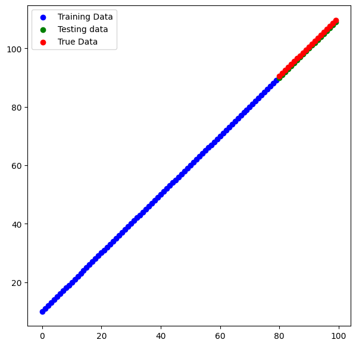

# DevFest Glasgow 2024: TensorFlow regression demo

This is the notebook I used for my talk "Google TensorFlow: Unleashing the Power of Tensors" at DevFest Glasgow 2024. It builds a small Keras neural network that learns the straight line y = x + 10 from 80 points and then predicts the 20 points it has not seen. The aim was to show the full TensorFlow workflow on a problem small enough to follow live.



In the plot, blue is the training data, green is the test data and red is the model's predictions for the test inputs (the legend in the notebook labels the predictions "True Data").

## How it works

1. Create the data with `tf.range(0, 100)` as X and `X + 10` as y.
2. Split by position: the first 80 points for training, the last 20 for testing. This means the model is tested on inputs larger than anything it trained on.
3. Build a `tf.keras.Sequential` model with four dense layers (10, 100, 10 and 1 units, ReLU on the two middle layers). It has 2,141 trainable parameters.
4. Compile with the Adam optimiser and mean absolute error (MAE) as the loss.
5. Train for 200 epochs, using the 20 test points as validation data.
6. Plot the predictions against the true values and try a single prediction.

## Results

From the saved notebook outputs:

| Measure | Value |
|---|---|
| Training MAE after epoch 200 | 0.32 |
| MAE on the 20 test points after epoch 200 | 0.56 |
| Prediction for x = 5 (true value 15) | 15.04 |

The validation MAE moves around quite a bit from epoch to epoch near the end of training (between 0.32 and 2.86 over the last ten epochs), so the final figure depends on where training stops.

## Repository layout

| Path | What it is |
|---|---|
| `Devfest.ipynb` | The notebook from the talk, with saved outputs |
| `Preds.png` | Plot of training data, test data and predictions |

## Running it

The notebook needs TensorFlow, NumPy, pandas and Matplotlib. There is no requirements file.

```
pip install tensorflow numpy pandas matplotlib
jupyter notebook Devfest.ipynb
```

It runs in a few seconds on a CPU. It also opens in Google Colab, where these libraries are already installed.

## Following along

If you were at the talk, run the cells from top to bottom. Changing the number of units in the hidden layers, the number of epochs or the train/test split point is a quick way to see how each one affects the predictions.

## Limitations

The data is synthetic and perfectly linear, so a single dense layer with no activation could solve it exactly. The deeper model is there to show how layers, activations and the optimiser fit together. No random seed is set, so a rerun will give slightly different numbers.
